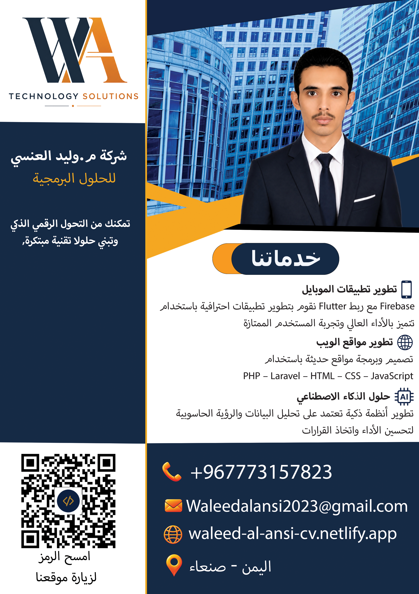
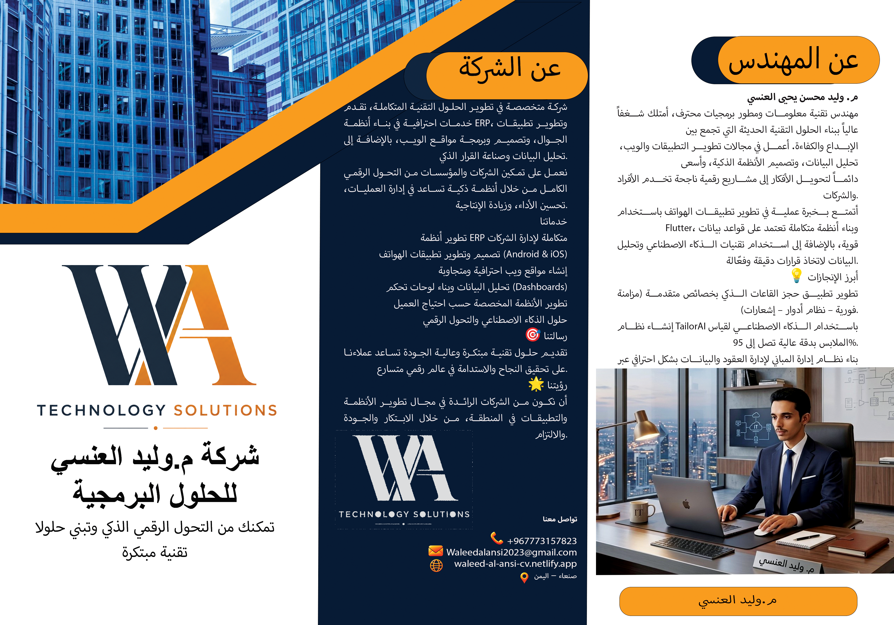
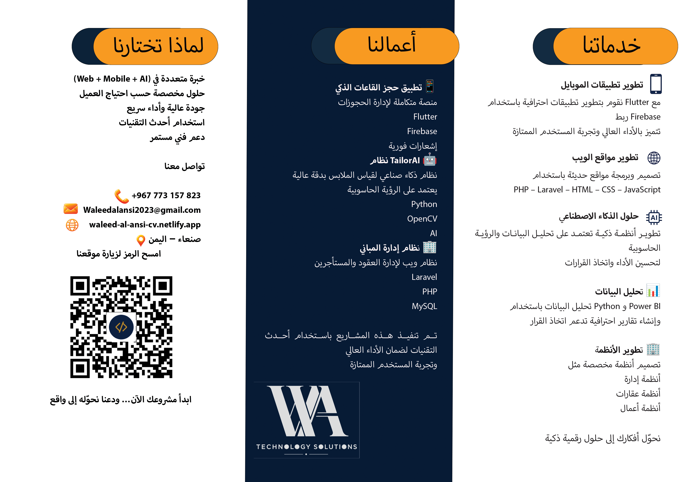
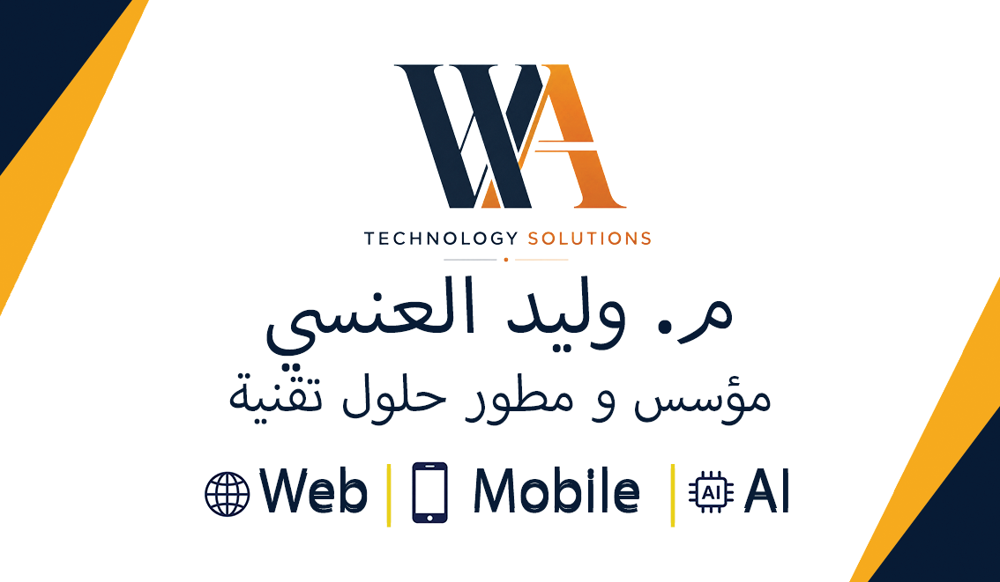
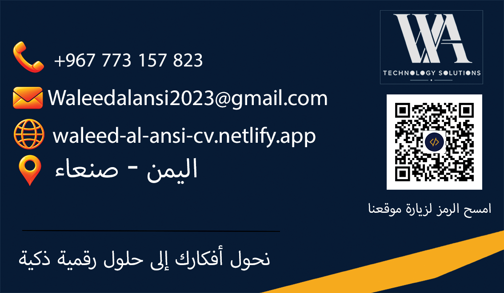



  <h1>🎨 WA Technology Solutions | تصاميم هوية بصرية للمهندس وليدالعنسي</h1>
  
Professional Photoshop Branding & Marketing Designs | تصاميم احترافية للهوية البصرية والتسويق

  

    <a href="#english">🇬🇧 English</a> • <a href="#arabic">🇸🇦 العربية</a>
  

  
  
  

---

## 🇬🇧 English Documentation

### 📌 About the Project
This repository contains a complete set of professional **Photoshop branding and marketing designs** created for **WA Technology Solutions** — a software company founded and led by **Eng. Waleed Mohsen Al-Ansi**, specializing in mobile application development, web development, AI solutions, and ERP systems. The design collection establishes a cohesive visual identity across all print and digital marketing materials, built around a navy blue and golden amber color palette that conveys professionalism, trust, and innovation.

### 🌟 Design Collection

- **🖼️ Marketing Poster:** A full-page promotional poster featuring the WA Technology Solutions logo, a professional photo of the engineer, a services overview (Mobile Apps, Web Development, AI Solutions), and full contact details with a QR code linking to the portfolio website.
- **📄 Brochure – Front Side:** A tri-fold brochure front presenting the company brand, services breakdown (Mobile App Development with Flutter & Firebase, Web Development with PHP/Laravel/HTML/CSS/JS, AI Solutions, Data Analysis with Power BI & Python, ERP Systems), notable projects (Smart Hall Booking App, TailorAI, Building Management System), and reasons to choose WA Technology Solutions.
- **📄 Brochure – Back Side:** The brochure's back panel featuring an "About the Engineer" biography, "About the Company" section (mission, vision, services list), a full contact block, and the WA logo.
- **💼 Business Card – Front:** A clean, modern business card front displaying the WA Technology Solutions logo, the engineer's name (**م. وليد العنسي**), title (Founder & Tech Solutions Developer), and expertise pillars (Web | Mobile | AI).
- **💼 Business Card – Back:** The business card back featuring a dark navy background with all contact information (phone, email, website, location), the WA logo, and a QR code for quick portfolio access.

### 🎨 Design Style & Branding

- **Color Palette:** Navy Blue (`#1A2744`) + Golden Amber (`#E8A020`) + White — conveying professionalism and innovation
- **Typography:** Modern Arabic + clean Latin fonts with strong hierarchy
- **Logo:** "WA" monogram with a bold navy W and golden A, paired with "TECHNOLOGY SOLUTIONS" wordmark
- **Layout:** Grid-based, balanced compositions with strategic use of geometric diagonal accents
- **Imagery:** Professional photography of the engineer integrated seamlessly into layouts

### 🗂️ Repository Contents

| File | Type | Description |
|------|------|-------------|
| `Waleed_Alansi_Poster.png` | PNG | Full marketing promotional poster |
| `Waleed_Alansi_Broshor_Front.png` | PNG | Tri-fold brochure – front/back side |
| `Waleed_Alansi_Broshor_Back.png` | PNG | Tri-fold brochure – inside panels |
| `Waleed_Alansi_Business_Card_Front.png` | PNG | Business card – front face |
| `Waleed_Alansi_Business_Card_Back.png` | PNG | Business card – back face |

### 🛠️ Tools Used

- **Adobe Photoshop** — primary design and layout tool
- **Custom Typography** — Arabic and Latin fonts for bilingual layouts
- **High-Resolution Export** — print-ready PNG files suitable for both digital and physical printing

### 📸 Design Preview

| Design | Preview |
|--------|---------|
| 🖼️ Marketing Poster |  |
| 📄 Brochure Front |  |
| 📄 Brochure Back |  |
| 💼 Business Card Front |  |
| 💼 Business Card Back |  |

 

---

## 🇸🇦 دليل الاستخدام (العربية)

### 📌 عن المشروع
يحتوي هذا المستودع على مجموعة كاملة من **تصاميم الهوية البصرية والتسويق الاحترافية** المصممة بـ **Adobe Photoshop** لشركة **WA Technology Solutions** — شركة برمجيات يأسسها ويقودها **م. وليد محسن العنسي**، المتخصصة في تطوير تطبيقات الموبايل، تطوير مواقع الويب، حلول الذكاء الاصطناعي، وأنظمة ERP. تُشكّل هذه المجموعة هوية بصرية متماسكة لجميع المواد التسويقية المطبوعة والرقمية، مبنية على لوحة ألوان بين الكحلي الداكن والذهبي الذهبي الدافئ التي تعكس الاحترافية والثقة والابتكار.

### 🌟 مجموعة التصاميم

- **🖼️ الملصق التسويقي:** ملصق دعائي كامل يتضمن شعار WA Technology Solutions، صورة احترافية للمهندس، نبذة عن الخدمات (تطبيقات الموبايل، تطوير الويب، حلول الذكاء الاصطناعي)، ومعلومات التواصل الكاملة مع رمز QR للوصول لموقع المحفظة.
- **📄 البروشور – الوجه الخارجي:** الوجه الأمامي والخلفي لبروشور ثلاثي الطيات يعرض هوية الشركة، وتفصيل الخدمات (تطوير التطبيقات بـ Flutter وFirebase، تطوير الويب بـ PHP/Laravel/HTML/CSS/JS، حلول الذكاء الاصطناعي، تحليل البيانات بـ Power BI وPython، تطوير الأنظمة)، وأبرز المشاريع (تطبيق حجز القاعات، نظام TailorAI، نظام إدارة المباني)، وأسباب اختيار الشركة.
- **📄 البروشور – الوجه الداخلي:** الألواح الداخلية تتضمن سيرة ذاتية للمهندس، قسم "عن الشركة" (رسالتنا، رؤيتنا، قائمة الخدمات)، معلومات التواصل، وشعار WA.
- **💼 بطاقة العمل – الوجه الأمامي:** وجه بطاقة عمل عصري ونظيف يعرض شعار WA Technology Solutions، اسم المهندس (**م. وليد العنسي**)، المسمى الوظيفي (مؤسس ومطور حلول تقنية)، وركائز الخبرة (Web | Mobile | AI).
- **💼 بطاقة العمل – الوجه الخلفي:** الوجه الخلفي بخلفية كحلي داكنة يتضمن كل معلومات التواصل (الهاتف، البريد الإلكتروني، الموقع، الموقع الجغرافي)، شعار WA، ورمز QR للوصول السريع للمحفظة.

### 🎨 أسلوب التصميم والهوية البصرية

- **لوحة الألوان:** الكحلي الداكن (`#1A2744`) + الذهبي الدافئ (`#E8A020`) + الأبيض — تعكس الاحترافية والابتكار
- **الخطوط:** خطوط عربية حديثة + خطوط لاتينية نظيفة بتسلسل هرمي واضح
- **الشعار:** مونوغرام "WA" بحرف W كحلي جريء وحرف A ذهبي، مقترن بـ "TECHNOLOGY SOLUTIONS"
- **التخطيط:** تصاميم شبكية متوازنة مع استخدام استراتيجي لعناصر هندسية قطرية
- **الصور:** تكامل احترافي لصورة المهندس ضمن التصاميم

### 🗂️ محتويات المستودع

| الملف | النوع | الوصف |
|-------|-------|--------|
| `Waleed_Alansi_Poster.png` | PNG | الملصق التسويقي الكامل |
| `Waleed_Alansi_Broshor_Front.png` | PNG | البروشور – الوجه الخارجي |
| `Waleed_Alansi_Broshor_Back.png` | PNG | البروشور – الألواح الداخلية |
| `Waleed_Alansi_Business_Card_Front.png` | PNG | بطاقة العمل – الوجه الأمامي |
| `Waleed_Alansi_Business_Card_Back.png` | PNG | بطاقة العمل – الوجه الخلفي |

### 🛠️ الأدوات المستخدمة

- **Adobe Photoshop** — الأداة الأساسية للتصميم والتخطيط
- **خطوط مخصصة** — خطوط عربية ولاتينية لتخطيطات ثنائية اللغة
- **تصدير بدقة عالية** — ملفات PNG جاهزة للطباعة تصلح للاستخدام الرقمي والمادي

### 📸 معاينة التصاميم

| التصميم | المعاينة |
|---------|----------|
| 🖼️ الملصق التسويقي |  |
| 📄 البروشور الخارجي |  |
| 📄 البروشور الداخلي |  |
| 💼 بطاقة العمل الأمامية |  |
| 💼 بطاقة العمل الخلفية |  |

 

---

  
Designed by <b>Eng. Waleed Mohsen Al-Ansi</b>

  
<b>تصميم وتطوير م. وليد محسن الآنسي</b>

  
📞 +967 773 157 823

  
🌐 <a href="https://waleed-al-ansi-cv.netlify.app">waleed-al-ansi-cv.netlify.app</a>

  
© 2026 WA Technology Solutions. All Rights Reserved.

  
© ٢٠٢٦ شركة م. وليد العنسي للحلول البرمجية. جميع الحقوق محفوظة.

